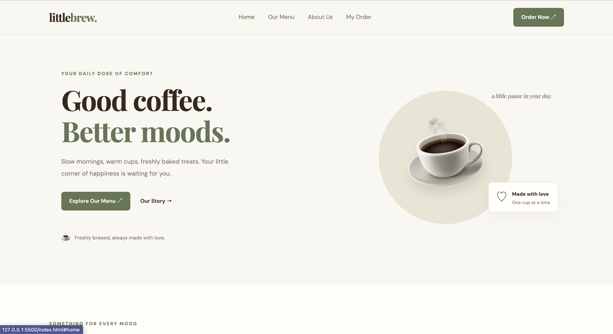
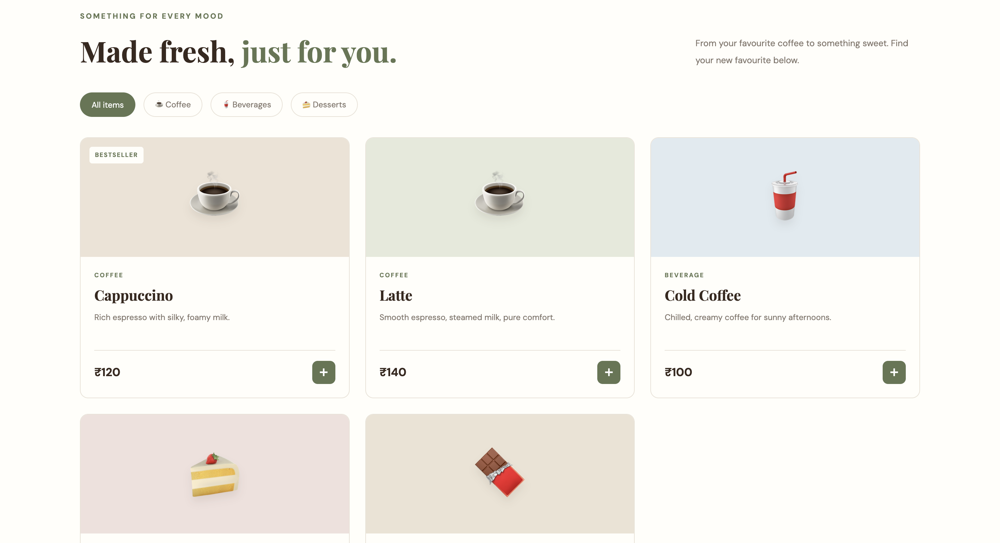
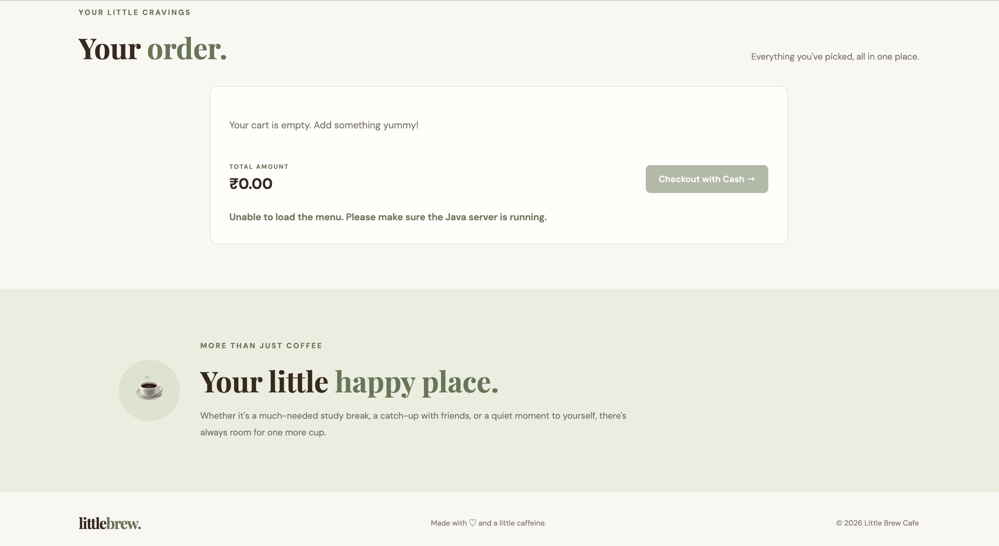

# Little Brew ☕

A simple café management system I built using Java OOP, HTML, CSS, and JavaScript.

### Features
- View menu items
- Add items to cart and place orders
- Calculate bills
- Admin panel to add, edit, and delete menu items
- View order history

### Technologies Used
- Java
- HTML, CSS, JavaScript

### How to Run
1. Compile the Java files using `javac -d out src/*.java`
2. Run the server using `java -cp out CafeServer`
3. Open another terminal and run `java -cp out AdminPanel`
4. Open `index.html` in your browser.

*This is a learning project, and the menu and orders are currently stored in memory.*

## Screenshots

### Home Page

### Menu

### Checkout

